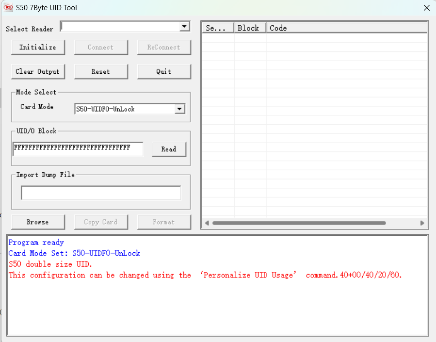

# fobtool — open 7‑byte UID magic MIFARE Classic writer (ACR122U)

`fobtool.py` reads and writes **7‑byte UID magic MIFARE Classic 1K** fobs/cards
(the USCUID / GDM‑class "ultimate" magic chips) over an **ACR122U** reader, from
plain Python via PC/SC.

I wrote it because I didn't want to keep using the closed‑source Chinese vendor
tool (**"S50 7Byte UID Tool"**, a VB6 app) to clone my own access fob. This is a
clean, open reimplementation of what that tool does — no installer, no mystery
binary, just one script you can read.



## What it does

- **`read`** — dump block 0 and report the UID, the **vanity SAK** (the byte a
  reader sees when it *reads* block 0) and the **live SAK** (what the chip
  actually transmits during anticollision). On these cards the two are stored
  separately, which is what lets a genuine card show `vanity 88 / live 08` — an
  anti‑clone trick ("Double Cross"). fobtool reproduces it faithfully.
- **`write <32 hex>`** — write a full 16‑byte block 0 (UID + SAK + ATQA +
  manufacturer bytes), including the separate live anticollision data and the
  gen‑mode config, so the clone matches the original byte‑for‑byte.

## Requirements

- An **ACR122U** (PN532‑based) PC/SC reader.
- Python 3 + [`pyscard`](https://pyscard.sourceforge.io/): `pip install pyscard`
- A 7‑byte UID magic (USCUID/GDM) card. **This will not work on normal cards or
  on plain Gen1a/Gen2 "magic" cards.**
- Windows, macOS or Linux (developed on Windows with the stock ACR122U driver).

## Usage

```sh
pip install pyscard

# read the card currently on the reader
python fobtool.py read

# write a block 0 (32 hex chars = 16 bytes)
python fobtool.py write 04112233445566884400C82000000000
```

A `write` prints `write OK` once the card has accepted it.

> **To validate a write, you often have to remove the tag and put it back.**
> Writing a new UID leaves the card’s RF state unstable until the reader
> re‑runs anticollision on the *new* UID, so the automatic read‑back verify
> after a write may not see the card. When that happens `fobtool` doesn’t fail —
> it prints something like
> `(could not auto-verify - re-present the fob (lift it off and put it back) and run: python fobtool.py read)`.
> Just **lift the fob off the reader and place it back**, then run
> `python fobtool.py read` to confirm the new UID. This is normal for these
> chips (the vendor tool shows it as a delayed beep). Success itself is reported
> from the write’s own acknowledgements, not from the read‑back, so a dropped
> card after writing is handled gracefully.

Close the vendor tool and any other reader software first — fobtool connects in
**exclusive** mode.

> ⚠️ Use this only on cards you own / are authorised to test. Cloning access
> credentials you don’t control may be illegal where you live.

## How the write works

The vendor "Set UID Info" is a four‑phase operation, all driven as ACR122U
*Direct Transmit* pseudo‑APDUs (`FF 00 00 00 <Lc> <PN532 frame>`) wrapping PN532
commands (`InDataExchange`, `InCommunicateThru`, `WriteRegister`,
`RFConfiguration`):

1. **Phase 2 – read:** authenticate block 0 (key A = `FF FF FF FF FF FF`), read
   it back, reset the RF field.
2. **Phase 3 – arm:** authenticate, then an authenticated **gen‑mode config
   write** (`7A …`). *This is the key step* — its effect is non‑volatile and
   survives a reset, and it is what lets the chip answer the backdoor knock in
   phase 4. Skip it and the knock times out forever.
3. **Phase 4 – write:**
   - **Backdoor entry:** CRC off → `HALT` → a **7‑bit `0x20`** short‑frame knock
     (`D5 43 00 0A` = backdoor open) → `0x23` → CRC on.
   - **Vanity write:** `A0 00 <16 block‑0 bytes>` — what a reader sees on *read*.
   - **Live + config writes:** `A8 00` / `88 <anticollision>` / `A8 01` / `6F …`
     / `E1 00` / `85 …` / `E0 00` — what the chip *transmits*, where the live
     SAK (`08`) lives independently of the vanity SAK (`88`).
   - RF field off/on to reset.

See the code — it’s commented frame‑by‑frame.

## How it was reverse‑engineered

No datasheet, so the protocol was recovered three ways that cross‑checked each
other:

1. **PC/SC sniffing** — ran the vendor tool through
   [**APDUPlay**](https://github.com/petrs/APDUPlay), a `winscard.dll` shim that
   logs every `SCardTransmit`. That gave the exact byte stream of a known‑good
   write (the "golden capture"), including the `D5 43 00 0A` backdoor ACK.
2. **API Monitor** — captured the WinSCard API calls to confirm the connection
   parameters (share mode **exclusive**, protocols **T0|T1**, disconnect
   `RESET_CARD`) and, crucially, to prove the write path is *pure*
   `SCardTransmit` — no `SCardControl`, no transactions, no hidden escape.
3. **Decompiling the VB6 binary** — confirmed it’s a plain `MSVBVM60` app, that
   its only delay routine is dead code (so timing isn’t a factor), and that the
   "Card Mode" dropdown just selects a SAK byte argument.

The one thing none of the captures made obvious was *why* a byte‑perfect knock
from Python kept returning `D5 43 01` (timeout) while the vendor’s identical
bytes returned `D5 43 00 0A`. The answer was the **phase‑3 `7A` arm**: the
vendor always runs its full session first, so by the time it knocks, the chip is
armed. Replaying that step was the whole ballgame.

## Files

- `fobtool.py` — the tool (read + write), standard library + `pyscard` only.
- `README.md` — this file.
- `7byte_tool.png` — the vendor VB6 tool this replaces.

## Credits / references

Info from these write‑ups helped me work out the fix (the gen‑mode "arm" step
and the SAK‑swap behaviour):

- Cloning a 7-byte UID MFC (Mifare Classic) 1k card and more - <https://gist.github.com/rickdoesburg/344a21b72623d5b47059ae6bdcff2122>
- Mifare Classic - SAK Swapping Explained - <https://gist.github.com/equipter/3022aea4e371e585ff6e46de637e7769>

Other references:

- APDUPlay — <https://github.com/petrs/APDUPlay>
- Magic‑card background (USCUID / GDM, SAK swap / "Double Cross") — the
  RfidResearchGroup Proxmark3 `magic_cards_notes.md`.

## License

[MIT](LICENSE). No warranty. For research and for working with your own cards.
